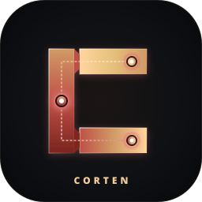

<div align="center">



# Corten Desktop Environment

**A modular Wayland desktop environment, compositor, and in-process local AI/vector subsystem written in pure Rust (`Smithay` + `Iced`).**

[](https://www.rust-lang.org)
[](https://wayland.freedesktop.org/)
[](LICENSE)
[](Cargo.toml)
[](#verification--test-suite)

[Architecture](#-system-architecture) •
[Engineering Breakdown](#-workspace-crate--codebase-breakdown) •
[Compositor & Protocols](#-compositor--wayland-protocol-implementation) •
[Embedded AI & Vector Engine](#-in-process-ai--vector-subsystem-corten-vector--corten-llm) •
[Build & Verify](#-building--verifying-from-source) •
[Design Trade-Offs](#-architectural-decisions--trade-offs)

---

</div>

## 1. Engineering Overview

**Corten Desktop** (`~68,700 LOC` across `130` Rust source files and `28` workspace crates) is a self-contained Wayland desktop environment built without C/C++ display server wrappers (`wlroots`), QML/JavaScript shell runtimes, or external Python daemons.

The repository is structured around three engineering pillars:
1. **Compositor Core (`corten-compositor`):** A `Smithay 0.3` DRM/KMS and nested-Winit compositor implementing hybrid Master-Stack + Binary Space Partitioning (`BspNode`) tiling, floating window magnetism, custom GLSL ES 3.0 Dual-Kawase blur and SDF halo shaders (`glow_shader.rs`), and direct hardware scanout.
2. **Process-Isolated Shell Suite (`corten-*`):** 17 independent Wayland `wlr-layer-shell` and XDG client binaries rendered via `Iced 0.13` (`tiny-skia` software rasterizer for deterministic low-VRAM shell surfaces) communicating over D-Bus (`zbus`) and a Unix domain socket JSON-RPC bus (`corten-ipc`).
3. **In-Process AI & Vector Subsystem (`corten-vector`, `corten-llm`, `corten-ai`):** An embedded, zero-cloud HNSW-like vector index with Write-Ahead Logging (WAL), a zero-copy `memmap2` GGUF quantized tensor inference engine (`Q4_K`, `Q6_K`, `Q5_0`, `Q8_0`, `F16`), and a 20-tool ReAct agent with a Human-In-The-Loop (`HITL`) security gate.

---

## 2. System Architecture

```
┌───────────────────────────────────────────────────────────────────────────────────┐
│                         USER SPACE / SHELL CLIENTS (Iced)                         │
│  corten-panel • corten-launcher • corten-files • corten-settings • corten-ai      │
│  corten-lock  • corten-greeter  • corten-notify • corten-monitor • corten-snipper │
└───────────────┬───────────────────────────────────┬───────────────────────────────┘
                │ Unix Socket JSON-RPC              │ In-Process Crate Linkage
                │ (`corten-ipc` / D-Bus `zbus`)     ▼
                │                    ┌──────────────────────────────────────────────┐
                │                    │      EMBEDDED AI & VECTOR ENGINE (Rust)      │
                │                    │ • `corten-vector`: HNSW Graph + WAL + LSH    │
                │                    │ • `corten-llm`: `mmap` GGUF + SIMD Quant     │
                │                    │ • `aura.rs`: 20-Tool ReAct + HITL Audit Gate │
                ▼                    └──────────────────────────────────────────────┘
┌───────────────────────────────────────────────────────────────────────────────────┐
│                      COMPOSITOR CORE (`corten-compositor`)                        │
│ • Layout Engine (`layout.rs`): Master-Stack, Recursive `BspNode`, Drag-to-Split   │
│ • GLSL Pipeline (`glow_shader.rs`): SDF-Masked Dual-Kawase Blur, Gaussian Halo    │
│ • KMS / DRM (`udev.rs`): Primary/Overlay Plane Scanout, VRR, HDR Metadata Blobs   │
│ • Sync & Input (`handlers.rs`, `tablet.rs`): `linux-drm-syncobj-v1`, Stylus v2    │
└───────────────┬───────────────────────────────────────────────────────────────────┘
                │ DRM ioctl / GBM / EGL / libinput / libseat / PipeWire
                ▼
┌───────────────────────────────────────────────────────────────────────────────────┐
│                               LINUX KERNEL (5.15+)                                │
└───────────────────────────────────────────────────────────────────────────────────┘
```

---

## 3. Workspace Crate & Codebase Breakdown

Every component in Corten is compiled from a single locked Cargo workspace (`Cargo.lock`) and can be audited independently:

| Crate / Path | Files | LOC | Technical Responsibility & Key Modules |
| :--- | :---: | :---: | :--- |
| [`corten-compositor`](corten-compositor/src/) | 11 | 14,653 | DRM/KMS (`udev.rs`) & Winit (`main.rs`) Wayland server, `LayoutManager` (`layout.rs`), GLSL shaders (`glow_shader.rs`), XWayland (`xwayland.rs`), Wacom tablet (`tablet.rs`), tearing (`tearing.rs`). |
| [`corten-panel`](corten-panel/src/) | 5 | 8,085 | Layer-shell top bar & dock, `org.kde.StatusNotifierWatcher` D-Bus tray, Waybar-compatible JSON script applets, PipeWire VU-meter, control center, mini task manager. |
| [`corten-launcher`](corten-launcher/src/) | 7 | 6,064 | App grid & command palette (`:p` dev projects, `:c` clipboard, `:e` emoji, color converter), integrated with `corten-vector` semantic file fallback (`files.rs`). |
| [`corten-settings`](corten-settings/src/) | 3 | 3,792 | Visual multi-monitor KScreen-style topology canvas (`offset_x`/`offset_y`), HDR10/ICC color controls, input/tiling rules, WCAG AAA accessibility toggles. |
| [`corten-files`](corten-files/src/) | 2 | 3,764 | Dual-pane file manager, multi-tab navigation, spacebar Quick Look preview, embedded terminal drawer (`F4`), archive extraction, context menu. |
| [`corten-ai`](corten-ai/src/) | 4 | 3,619 | Layer-shell AI HUD (`main.rs`), multi-backend streaming engine (`engine.rs`), ReAct orchestrator, persistent memory & 20-tool registry (`aura.rs`), reflex desktop actions (`actions.rs`). |
| [`crates/services`](crates/services/src/) | 2 | 2,657 | Hardware & D-Bus backends: `color_management.rs` (CIE 1931 gamut matrices, SMPTE ST.2084 PQ EOTF, ICC binary parser, 32-byte DRM `hdr_output_metadata`), `a11y` AT-SPI2 object tree (`org.a11y.atspi.Accessible`). |
| [`crates/llm`](crates/llm/src/) | 21 | 1,961 | Pure-Rust GGUF parser (`gguf.rs`), block dequantizers (`quant.rs`: `Q4_K`, `Q6_K`, `Q5_0`, `Q8_0`, `F16`), `RMSNorm`/`RoPE`/`SwiGLU` (`ops.rs`), `KVCache`, `ModelRunner`. |
| [`corten-session`](corten-session/src/) | 2 | 1,645 | Session supervisor with crash recovery (`compositor_restart_count <= 3`), environment export, and daemon lifecycle orchestration. |
| [`corten-welcome`](corten-welcome/src/) | 2 | 1,520 | First-boot hardware telemetry inspector (`/proc/cpuinfo`, `/proc/meminfo`, DRM GPU detection) and interactive configuration wizard. |
| [`corten-widgets`](corten-widgets/src/) | 8 | 1,324 | `Layer::Bottom` desktop HUD cards (radial CPU/RAM gauges, audio waveform visualizer, clock) synchronized with active Patina palettes. |
| [`corten-notify`](corten-notify/src/) | 3 | 1,304 | `org.freedesktop.Notifications` D-Bus daemon, per-app `+N` badge grouping, urgency timeouts, and DND filtering. |
| [`corten-monitor`](corten-monitor/src/) | 1 | 1,284 | Process and hardware telemetry viewer reading directly from `/proc` and `/sys/class/hwmon` with `SIGTERM`/`SIGKILL` controls. |
| [`corten-lock`](corten-lock/src/) | 2 | 1,132 | `ext-session-lock-v1` / layer-shell screen locker with PAM authentication (`corten-auth`), MPRIS media controls, and failure shake physics. |
| [`corten-snipper`](corten-snipper/src/) | 1 | 1,011 | `zwlr_screencopy_manager_v1` capture utility with region crop, `--delay` countdown, `--pin` always-on-top overlay, and sensitive-text redaction brush. |
| [`crates/i18n`](crates/i18n/src/) | 1 | 966 | Compile-time type-safe localization for 7 languages (`TR`, `EN`, `DE`, `FR`, `ES`, `RU`, `JA`). |
| [`crates/theme`](crates/theme/src/) | 9 | 898 | Design tokens, 4 industrial Patina palettes (`Rust`, `Emerald`, `Titanium`, `AmberGold`), WCAG contrast verifier, Brettel/Machado color-blindness matrices, spring physics (`animation.rs`). |
| [`corten-portal`](corten-portal/src/) | 1 | 795 | `org.freedesktop.impl.portal.ScreenCast` D-Bus service querying compositor windows/outputs and spawning PipeWire streams. |
| [`crates/config`](crates/config/src/) | 1 | 759 | TOML schema definitions (`~/.config/corten/`) with `notify` file-watcher hot-reload. |
| [`corten-greeter`](corten-greeter/src/) | 4 | 709 | Display manager login UI with `greetd` IPC protocol client (`greetd_ipc.rs`). |
| [`crates/vector`](crates/vector/src/) | 4 | 691 | Concurrent `RwLock<InnerState>` vector engine (`index.rs`), navigable small-world graph, inverted metadata index, JSONL WAL (`wal.rs`), LSH text embedder (`types.rs`). |
| [`crates/capture`](crates/capture/src/) | 1 | 622 | Bounded ring-buffer frame pump and raw/PipeWire capture primitives. |
| [`corten-polkit`](corten-polkit/src/) | 1 | 579 | Privilege escalation authentication dialog for Polkit actions. |
| [`corten-wallpaper`](corten-wallpaper/src/) | 1 | 456 | `Layer::Background` wallpaper renderer with K-Means/luminance dominant color extraction (`extract_ambiance_color`) for automatic Patina theme sync. |
| [`crates/ipc`](crates/ipc/src/) | 2 | 357 | D-Bus proxy (`org.corten.Compositor`) and Unix socket JSON-RPC event stream protocol, plus the `cortenctl` CLI binary. |

---

## 4. Compositor & Wayland Protocol Implementation

### Window Management (`corten-compositor/src/layout.rs`)
* **Master-Stack & Recursive BSP Tree (`BspNode`):** Supports both classic Master-Stack ratios and arbitrary binary space partitioning (`SplitDirection::Horizontal` / `Vertical`).
* **Interactive Drag-to-Split (`detect_drag_split_target`):** Dragging a window into the inner 25% edge zone of another tiled window computes a live split preview rectangle and inserts a new `BspNode::Split` branch on release.
* **14px Edge & Window Magnetism (`snap_window_to_edges`, `snap_window_resize`):** Floating windows snap against output work-areas (respecting panel exclusive zones) and neighboring window edges.
* **Output Hotplug Rescue (`drain_all_windows`, `clamp_floating_geometries_to_area`):** Disconnecting a DRM connector migrates orphaned workspaces and clamps floating window coordinates onto the primary output.

### GLSL ES Shader Pipeline (`corten-compositor/src/glow_shader.rs`)
* **SDF-Masked Dual-Kawase Blur (`DUAL_KAWASE_DOWN_SRC`, `DUAL_KAWASE_UP_SRC`):** Multi-pass downsample/upsample blur with signed-distance-field (`rounded_box`) corner clipping (`GlassRegion`), preventing rectangular blur bleed outside rounded window or dock corners.
* **Active Window Gaussian Halo (`HALO_FRAGMENT_SRC`):** Hardware-accelerated border glow synchronized with the active Patina accent color.

### DRM/KMS Scanout, Sync & Color (`corten-compositor/src/udev.rs`, `handlers.rs`)
* **Direct Scanout & Overlay Planes:** Fullscreen surfaces and hardware-decoded video subsurfaces use `FrameFlags::ALLOW_PRIMARY_PLANE_SCANOUT_ANY | FrameFlags::ALLOW_OVERLAY_PLANE_SCANOUT` to bypass OpenGL composition.
* **Explicit Sync (`linux-drm-syncobj-v1`):** Registers `DrmSyncobjState` when `supports_syncobj_eventfd` is present; attaches a pre-commit acquire point blocker (`acquire_point.generate_blocker()`) and signals the client release point upon buffer scanout completion.
* **Async Tearing (`wp_tearing_control_v1`):** Bypasses VBlank wait loops in `udev.rs` when the focused fullscreen surface requests `PresentationHint::Async`.
* **DRM HDR10 & Color Management (`crates/services/src/color_management.rs`):** Serializes Linux kernel `hdr_output_metadata` (32-byte `CEA-861-G` static metadata Type 1 with SMPTE ST.2084 PQ EOTF and 0.00002 fixed-point primaries) into DRM `HDR_OUTPUT_METADATA` property blobs.

---

## 5. In-Process AI & Vector Subsystem (`corten-vector` + `corten-llm` + `aura.rs`)

Unlike desktop wrappers that rely on cloud APIs or external Python/FastAPI servers, Corten embeds its vector database, GGUF tensor runner, and ReAct agent directly in Rust:

### 1. `corten-vector` ([`crates/vector/src/index.rs`](crates/vector/src/index.rs))
* **Storage & Concurrency:** Thread-safe `Arc<RwLock<InnerState>>` storing normalized `VectorPoint` arrays, an inverted metadata index (`HashMap<String, HashMap<String, HashSet<usize>>>`), and a tombstone set (`HashSet<usize>`) with in-place `vacuum()` compaction.
* **Search & Filtering:** Parallel Rayon distance evaluation (`par_iter`) with a navigable small-world neighbor graph (`build_hnsw_index`, `M_MAX = 16`) and metadata operators (`==`, `!=`, `>`, `<`, `>=`, `<=`).
* **Crash-Safe Persistence (`wal.rs`):** Append-only JSON-lines Write-Ahead Log (`WalEntry::Insert`, `WalEntry::Delete`) replayed automatically on `load_from_disk`.
* **Zero-Dependency LSH Text Embedder (`embed_text`):** Projects words, character trigrams, and word bigrams into a 128-dimensional L2-normalized vector using deterministic FNV-1a signed feature hashing, enabling `<0.2ms` semantic indexing in `corten-launcher` and `corten-ai` without requiring multi-gigabyte embedding weights on disk.

### 2. `corten-llm` ([`crates/llm/src/`](crates/llm/src/))
* **Zero-Copy GGUF Loader (`gguf.rs`):** Maps `.gguf` model files into virtual memory via `memmap2::Mmap`, parsing tensor descriptors and tokenizer vocabulary headers without copying weight buffers into heap RAM.
* **Quantized Kernels (`quant.rs`):** Pure-Rust block dequantization and dot-product routines for `GGMLType::Q4_K`, `Q6_K`, `Q5_0`, `Q8_0`, and IEEE 754 `F16`.
* **Transformer Execution (`ops.rs`, `engine/`):** Parallel Rayon matrix-vector multiplication (`matmul_quantized`), `rms_norm`, `apply_rope` (Rotary Positional Embeddings), `swiglu`, `MultiHeadAttention` with `KVCache`, and temperature / Top-K / Top-P nucleus sampling.
* **Hybrid Backend Auto-Detection (`corten-ai/src/engine.rs`):** Automatically discovers local `.gguf` files in `~/.local/share/corten/models/` for in-process `NativeGguf` execution, while also probing loopback sockets for `Ollama` (`127.0.0.1:11434`, including multimodal Vision `llava`/`qwen2-vl` screen analysis) and `llama-server` (`127.0.0.1:8080`) when GPU offloading (CUDA/ROCm/Vulkan) is desired.

### 3. `aura.rs` ([`corten-ai/src/aura.rs`](corten-ai/src/aura.rs))
* **Persistent Long-Term Memory:** Stores user identity, preferences, and learned facts in `~/.local/share/corten/aura/user_profile.json` and `memory_vector.wal`, recalling top-K relevant memories into LLM system prompts.
* **20-Tool Native Registry (`AuraToolRegistry`):** Built-in recursive-descent math evaluator (`calculator`), `/proc` telemetry (`system_info`), file/Git inspection (`read_file`, `write_file`, `list_files`, `git_status`, `git_diff`, `run_terminal_command`), and 9 Wayland desktop automation tools (`corten_set_volume`, `corten_set_brightness`, `corten_switch_workspace`, `corten_window_action`, `corten_list_windows`, `corten_take_screenshot`, `corten_send_notification`, `corten_toggle_night_light`, `corten_system_power`).
* **HITL Security Gate (`HitlSecurityGate`):** Intercepts destructive commands (`rm -rf`, `mkfs`, `dd if=`, `sudo`, `poweroff`) before execution and writes timestamped audit trails to `~/.local/share/corten/aura/hitl_audit.log`.

---

## 6. Architectural Decisions & Trade-Offs

To keep expectations concrete for developers and contributors, here are the explicit engineering trade-offs in Corten's current design:

1. **In-Process CPU GGUF (`corten-llm`) vs. External GPU Offload (`Ollama` / `llama.cpp`):**
   * `corten-llm` executes entirely on CPU using Rayon thread pools and quantized dot-product kernels. It requires zero external libraries (no CUDA/ROCm SDKs) and works out-of-the-box for compact `0.5B–3B` GGUF models. For `7B+` models or multimodal Vision (`VLM`) inference requiring dedicated GPU VRAM, `corten-ai` automatically switches to its loopback HTTP/SSE adapter (`127.0.0.1:11434` / `8080`).
2. **Deterministic LSH Hashing vs. Neural Transformer Embeddings:**
   * `corten-vector` supports arbitrary `f32` embedding vectors of any dimension. For built-in desktop file search (`embed_text`), it uses 128-dim LSH character/word n-gram projection so that `corten-launcher` starts instantaneously with `0 MB` of model weight overhead.
3. **Shell Rendering (`tiny-skia`) vs. Compositor Rendering (`GLES2 / Glow`):**
   * `corten-compositor` uses hardware-accelerated OpenGL ES / DRM planes for 60–240Hz composition, whereas layer-shell clients (`corten-panel`, `corten-settings`, `corten-ai`) use `iced` with the `tiny-skia` backend. This avoids allocating separate EGL/VRAM contexts for every background microservice, keeping total desktop idle RAM around `~180 MB`.

---

## 7. Building & Verifying from Source

### System Dependencies
* **Arch Linux:**
  ```bash
  sudo pacman -S base-devel rust clang wayland libxkbcommon libseat systemd mesa libinput pipewire wireplumber pam brightnessctl wl-clipboard librsvg
  ```
* **Ubuntu / Debian:**
  ```bash
  sudo apt install build-essential pkg-config cargo clang libclang-dev llvm-dev libwayland-dev libxkbcommon-dev libseat-dev libudev-dev libgbm-dev libdrm-dev libegl1-mesa-dev libgles2-mesa-dev libinput-dev libpam0g-dev libpipewire-0.3-dev libspa-0.2-dev libdbus-1-dev librsvg2-bin wl-clipboard
  ```

### Compile & Run Verification Suite

```bash
# 0. Clone the repository
git clone https://github.com/Shura5800/corten-desktop.git
cd corten-desktop

# 1. Run all 123 unit tests across the 28 workspace crates
cargo test --workspace

# 2. Run strict static analysis (zero warnings policy)
cargo clippy --workspace -- -D warnings

# 3. Build optimized release binaries
cargo build --release

# 4. Install system-wide (binaries to /usr/local/bin + Wayland session file)
sudo ./install.sh
```

### Verification & Test Suite Breakdown (`123 Passed / 0 Failed`)
* `corten-compositor`: **31 unit tests** (BSP tree splitting, magnetic edge snapping, kinetic gesture velocity & spring convergence, Dual-Kawase glass regions, crisp titlebar glyph rendering, DRM overlay plane flags, Multi-GPU node structure, Wacom tablet descriptors, XWayland scale math, explicit sync eventfd detection).
* `corten-ai`: **15 unit tests** (20-tool registry verification, recursive-descent calculator evaluation, multi-step ReAct workflow execution, HITL security gate blocking & audit logging, RFC 4648 Base64 encoding, natural-language intent parsing).
* `corten-services`: **9 unit tests** (CIE 1931 gamut matrix inverses, sRGB/ST.2084 PQ EOTF roundtrips, 32-byte DRM HDR metadata serialization, synthetic ICC profile generation & parsing, AT-SPI2 accessibility tree).
* `corten-panel`, `corten-settings`, `corten-files`, `corten-launcher`, `corten-welcome`, `corten-theme`, `corten-snipper`, `corten-wallpaper`, `corten-vector`, `corten-llm`, `corten-portal`, `corten-capture`, `corten-auth`: **68 unit tests**.

---

## 8. Default Keybindings & IPC CLI (`cortenctl`)

Keybindings are configured in `~/.config/corten/corten.toml`:

| Shortcut | Command / Action |
| :--- | :--- |
| <kbd>Super</kbd> + <kbd>Return</kbd> | Launch terminal |
| <kbd>Super</kbd> + <kbd>Space</kbd> | Application & semantic file launcher (`corten-launcher`) |
| <kbd>Super</kbd> + <kbd>Alt</kbd> + <kbd>Space</kbd> | Local AI & ReAct Assistant HUD (`corten-ai`) |
| <kbd>Super</kbd> + <kbd>E</kbd> | File manager (`corten-files`) |
| <kbd>Super</kbd> + <kbd>I</kbd> | Settings & KScreen topology canvas (`corten-settings`) |
| <kbd>Super</kbd> + <kbd>W</kbd> | Window Overview / Exposé |
| <kbd>Super</kbd> + <kbd>B</kbd> / <kbd>V</kbd> | Set horizontal / vertical BSP split direction |
| <kbd>Super</kbd> + <kbd>1</kbd> .. <kbd>9</kbd> | Switch workspace `1..9` (`cortenctl action workspace <N>`) |

```bash
# Subscribe to real-time compositor events over Unix domain socket
cortenctl subscribe

# Query active Wayland windows
cortenctl action windows

# Trigger AI security audit on a local script
corten-ai --audit ./install.sh
```

---

## 9. Contributing & License

See [CONTRIBUTING.md](CONTRIBUTING.md) for code style rules, offline testing flags, and pull request guidelines.

Licensed under the **GNU General Public License v3.0** ([LICENSE](LICENSE)).
