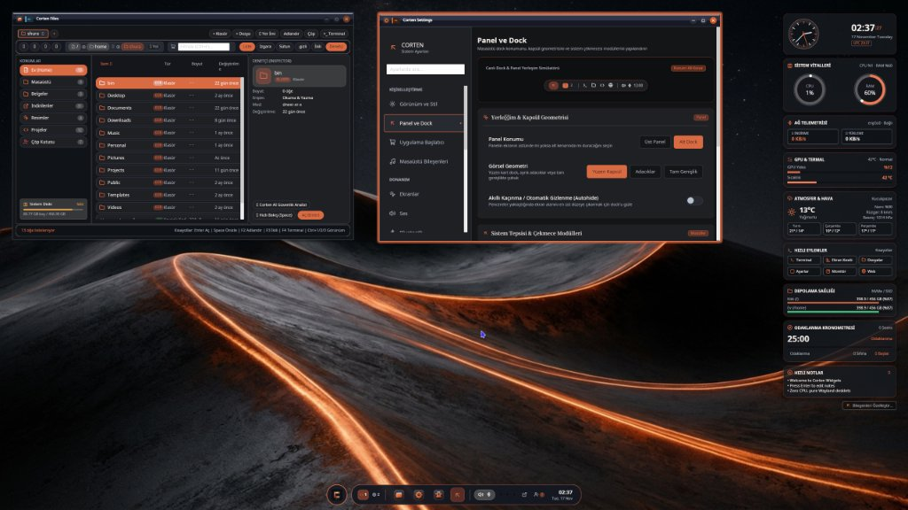

<div align="center">


# Corten Desktop

**A lightweight Wayland desktop environment and compositor written in Rust (Smithay + Iced).**

[](https://github.com/Shura5860/corten-desktop/releases/tag/v0.6.0)
[](https://www.rust-lang.org)
[](https://wayland.freedesktop.org/)
[](https://github.com/Smithay/smithay)
[-blueviolet.svg?style=flat-square)](https://github.com/iced-rs/iced)
[](#-building-from-source)
[](LICENSE)

<br />

<p align="center">
  <a href="#-overview">Overview</a> •
  <a href="#-screenshots">Screenshots</a> •
  <a href="#-workspace-components">Components</a> •
  <a href="#-installation">Installation</a> •
  <a href="#-building-from-source">Build</a> •
  <a href="#-keyboard-shortcuts">Shortcuts</a>
</p>

---

</div>

<br />


<br />

## Overview

Corten Desktop is a full Wayland desktop environment built inside a single Rust Cargo workspace.

The goal of the project is simple: provide a lightweight desktop session where the compositor, panel/dock, lock screen, file manager, settings app, notifications, and desktop utilities all work together out of the box without high resource usage or needing to manually wire together a dozen separate tools and scripts.

* **Compositor (`corten-compositor`):** Built on `Smithay 0.7` with DRM/KMS direct scanout, XWayland support, Dual-Kawase blur shaders, VRR, tearing control, and both floating and tiling window layouts (Master-Stack, BSP, Monocle, and Scrollable strip).
* **Desktop Shell & Apps (`Iced 0.13`):** Shell surfaces and built-in applications use `Iced` with the `tiny-skia` software renderer so background desktop utilities stay light on system VRAM.
* **Unified IPC (`corten-ipc`):** Components communicate over D-Bus (`zbus`) and a Unix domain socket controllable via `cortenctl`.

### Development Note

Corten Desktop is an independent personal project built with AI-assisted development tools—especially on the UI/shell side—while architecture, compositor integration, testing, and direction are driven manually. Design feedback, UI/UX suggestions, and compositor reviews are very welcome.

---

## Screenshots

### Desktop, Floating Dock & Widgets


### Package Manager (`corten-forge`) & Local Assistant (`corten-ai`)


### File Manager (`corten-files`) & System Settings (`corten-settings`)


---

## Workspace Components

| Crate | Role |
| :--- | :--- |
| `corten-compositor` | Wayland compositor (DRM/KMS + winit nested mode, XWayland, floating & tiling layouts) |
| `corten-session` | Session supervisor and environment launcher |
| `corten-panel` | Floating capsule dock, upward app drawer, system tray (SNI), and quick controls |
| `corten-launcher` | Application launcher, calculator, clipboard history, and file search |
| `corten-lock` | `ext-session-lock-v1` lock screen with PAM authentication |
| `corten-greeter` | `greetd` login screen |
| `corten-files` | Dual-pane file manager with quick preview and integrated terminal drawer |
| `corten-settings` | System settings (display topology, audio, network, Bluetooth, themes, keybindings) |
| `corten-notify` | Desktop notification daemon (`org.freedesktop.Notifications`) |
| `corten-widgets` | Desktop widgets (clock, weather, media player, GPU/system monitor, pomodoro) |
| `corten-wallpaper` | Wallpaper daemon with multi-monitor support |
| `corten-snipper` | Region screenshot and annotation tool |
| `corten-monitor` | Process and system resource monitor |
| `corten-forge` | Package manager front-end for Flatpak, Arch packages, and updates |
| `corten-portal` / `corten-polkit` | XDG Desktop Portal backend and Polkit authentication agent |
| `corten-ai` / `crates/llm` / `crates/vector` | Optional local assistant and GGUF inference helpers |
| `crates/ipc` (`cortenctl`) | CLI tool for controlling the compositor, querying windows, and running `cortenctl doctor` |

---

## Installation

### Quick Install (Arch Linux)

```bash
./scripts/quick-install.sh
```

### Distribution Packages (`v0.6.0`)

* **Arch Linux (PKGBUILD):**
  ```bash
  cd packaging/arch && makepkg -si
  ```
* **NixOS / Nix Flake:**
  ```bash
  nix build github:Shura5860/corten-desktop
  ```
* **Precompiled Binary Install:**
  ```bash
  curl -fsSL https://raw.githubusercontent.com/Shura5860/corten-desktop/main/scripts/install-release-bin.sh | sudo bash
  ```
* **Debian / Ubuntu (`.deb` builder):**
  ```bash
  ./packaging/debian/build-deb.sh 0.6.0
  sudo dpkg -i target/debian/corten-desktop_0.6.0_*.deb
  ```
* **Fedora / RHEL (RPM Spec):**
  ```bash
  rpmbuild -ba packaging/rpm/corten-desktop.spec
  ```

---

## Building from Source

### System Prerequisites

* **Arch Linux / Manjaro:**
  ```bash
  sudo pacman -S base-devel rust clang wayland libxkbcommon libseat systemd mesa libinput pipewire wireplumber pam brightnessctl wl-clipboard
  ```

* **Ubuntu / Debian:**
  ```bash
  sudo apt install build-essential pkg-config cargo clang libclang-dev llvm-dev libwayland-dev libxkbcommon-dev libseat-dev libudev-dev libgbm-dev libdrm-dev libegl1-mesa-dev libgles2-mesa-dev libinput-dev libpam0g-dev libpipewire-0.3-dev libspa-0.2-dev libdbus-1-dev wl-clipboard
  ```

* **Fedora:**
  ```bash
  sudo dnf install @development-tools rust cargo clang clang-devel wayland-devel libxkbcommon-devel libseat-devel systemd-devel mesa-libEGL-devel mesa-libGLES-devel libinput-devel pam-devel pipewire-devel wl-clipboard
  ```

### Compile & Install

```bash
git clone https://github.com/Shura5860/corten-desktop.git
cd corten-desktop

# Run tests and clippy checks
cargo test --workspace
cargo clippy --workspace --all-targets -- -D warnings

# Build release binaries and install session files
cargo build --release --workspace
sudo ./install.sh
```

Once installed, you can select **Corten Desktop** from your display manager, enable the built-in greeter with `sudo corten-enable-greeter`, or launch directly from a TTY with `corten-session`.

You can also verify system dependencies and hardware setup anytime with:

```bash
cortenctl doctor
```

---

## Keyboard Shortcuts

Keybindings can be customized in `~/.config/corten/corten.toml`:

| Shortcut | Description |
| :--- | :--- |
| <kbd>Super</kbd> + <kbd>Return</kbd> | Launch default terminal (`alacritty`, `foot`, `kitty`) |
| <kbd>Super</kbd> + <kbd>Space</kbd> | Open application launcher (`corten-launcher`) |
| <kbd>Super</kbd> + <kbd>Alt</kbd> + <kbd>Space</kbd> | Open local assistant HUD (`corten-ai`) |
| <kbd>Super</kbd> + <kbd>E</kbd> | Open file manager (`corten-files`) |
| <kbd>Super</kbd> + <kbd>I</kbd> | Open system settings (`corten-settings`) |
| <kbd>Super</kbd> + <kbd>W</kbd> | Toggle window overview / Exposé |
| <kbd>Super</kbd> + <kbd>D</kbd> | Toggle Show Desktop |
| <kbd>Super</kbd> + <kbd>Shift</kbd> + <kbd>S</kbd> | Region screenshot with annotation editor (`corten-snipper`) |
| <kbd>Super</kbd> + <kbd>.</kbd> | Built-in Emoji & Unicode picker |
| <kbd>Super</kbd> + <kbd>Shift</kbd> + <kbd>C</kbd> | Color picker (`#RRGGBB` to clipboard) |
| <kbd>Super</kbd> + <kbd>-</kbd> / <kbd>Super</kbd> + <kbd>Shift</kbd> + <kbd>-</kbd> | Toggle scratchpad / Move active window to scratchpad |
| <kbd>Super</kbd> + <kbd>S</kbd> | Pin active window across all workspaces (Sticky / PiP) |
| <kbd>Super</kbd> + <kbd>G</kbd> | Toggle Game Mode (VRR + Tearing + Blur Bypass + DND) |
| <kbd>Super</kbd> + <kbd>=</kbd> / <kbd>Super</kbd> + <kbd>Ctrl</kbd> + <kbd>Scroll</kbd> | Screen magnifier zoom in / out (`Super + 0` resets) |
| <kbd>Super</kbd> + <kbd>[</kbd> / <kbd>Super</kbd> + <kbd>]</kbd> | Scroll left / right in Scrollable Tiling layout |
| <kbd>Super</kbd> + <kbd>R</kbd> | Cycle scrollable column width (`33%` / `50%` / `66%` / `100%`) |
| <kbd>PrtScn</kbd> | Fullscreen screenshot (saved to `~/Pictures/` & clipboard) |
| <kbd>Super</kbd> + <kbd>1</kbd> .. <kbd>9</kbd> | Switch to workspace `1..9` |
| <kbd>Super</kbd> + <kbd>Shift</kbd> + <kbd>1</kbd> .. <kbd>9</kbd> | Move active window to workspace `1..9` |
| <kbd>Ctrl</kbd> + <kbd>Alt</kbd> + <kbd>Backspace</kbd> | Emergency session exit to TTY (when unlocked) |

---

## License

Licensed under the **GNU General Public License v3.0** ([LICENSE](LICENSE)).
