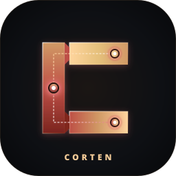
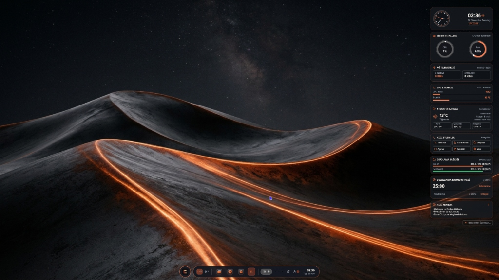
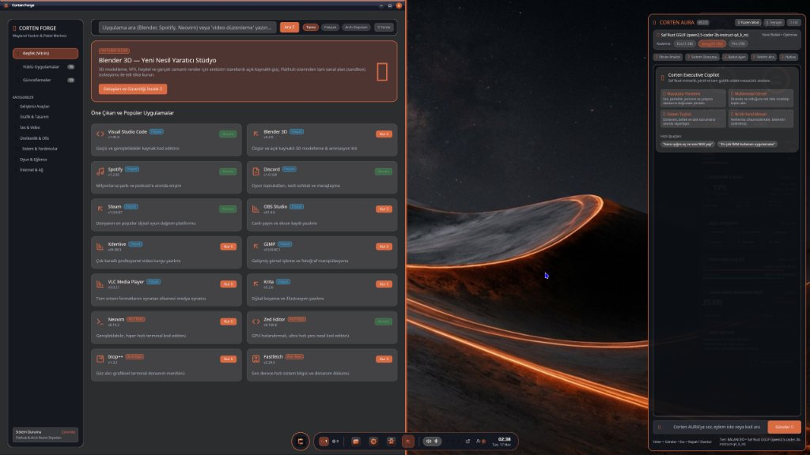

<div align="center">



# Corten Desktop Environment

**A purpose-built, process-isolated Wayland desktop ecosystem forged in pure Rust.**  
*Zero C display wrappers (`wlroots`), zero Electron/WebKit runtimes, and zero fragile glue scripts.*

[](https://www.rust-lang.org)
[](https://wayland.freedesktop.org/)
[](https://github.com/Smithay/smithay)
[-blueviolet.svg?style=flat-square)](https://github.com/iced-rs/iced)
[](#-verifying--building-from-source)
[](LICENSE)

<br />

<p align="center">
  <a href="#-the-corten-thesis">The Thesis</a> •
  <a href="#-visual-showcase">Visual Showcase</a> •
  <a href="#-engineering-architecture">Architecture</a> •
  <a href="#-in-process-ai--vector-subsystem">Local AI Subsystem</a> •
  <a href="#-autonomous-ota--package-management">Forge & OTA</a> •
  <a href="#-hardware-diagnostics-probe">System Doctor</a> •
  <a href="#-verifying--building-from-source">Build & Install</a>
</p>

---

</div>

<br />



<br />

## 1. The Corten Thesis

For over a decade, Linux desktop environments have oscillated between two extremes:

1. **The Heavyweight Monoliths:** Traditional desktop environments that ship with millions of lines of legacy C/C++ code, deep external dependencies, and background JavaScript/QML runtimes.
2. **The Fragile Window Manager Rigs:** Tiling setups stitched together with dozens of uncoordinated tools—a compositor from one project, a bar from another, a notification daemon from a third, all bound together by custom Python and Bash glue scripts that break on library updates.

**Corten is the architectural rejection of both compromises.**

It is an integrated, cohesive desktop environment engineered from the kernel DRM/KMS layer up to the desktop widgets as a single, strongly-typed Cargo workspace. Every component—the compositor, the floating capsule dock, the notification server, the package manager, the file navigator, and the local AI copilot—speaks the same IPC protocol, shares the same memory-safe foundation, and adheres to a singular industrial design language (**Forged Steel & Glowing Copper**).

---

## 2. Visual Showcase

### Clean Desktop & Modular HUD
> *A low-latency desktop surface featuring hardware-accelerated GLSL ES Dual-Kawase glass shaders, a floating capsule dock, and real-time telemetry widgets.*


---

### Corten Forge & AURA Copilot
> *Left: **Corten Forge**, a unified package manager orchestrating Flatpak sandboxes, Arch repositories, and Corten Core OTA releases.  
> Right: **Corten AURA**, an embedded, zero-cloud desktop copilot powered by pure-Rust GGUF tensor inference and a 20-tool ReAct automation engine.*



---

### Corten Files & System Settings
> *Left: **Corten Files**, a dual-pane file manager with spacebar Quick Look, inline terminal drawer, and AI safety inspection.  
> Right: **Corten Settings**, featuring an interactive multi-monitor topology canvas, hardware audio/display management, and Patina theme accents.*


---

## 3. Engineering Architecture

Corten is designed around strict separation of concerns, process isolation, and asynchronous IPC. A failure in a shell applet or UI client cannot compromise compositor stability.

```
┌─────────────────────────────────────────────────────────────────────────────────────────────────┐
│                                   SHELL & USER SPACE (Iced)                                     │
│   corten-panel   •   corten-launcher   •   corten-files   •   corten-settings   •   corten-ai   │
│   corten-forge   •   corten-widgets    •   corten-lock    •   corten-notify     •   cortenctl   │
└───────────────────┬─────────────────────────────────────────────┬───────────────────────────────┘
                    │ D-Bus (`zbus`) / Unix JSON-RPC              │ In-Process Linkage
                    │ (`corten-ipc`)                              ▼
                    │                              ┌──────────────────────────────────────────────┐
                    │                              │      EMBEDDED AI & VECTOR SUBSYSTEM          │
                    │                              │ • `corten-vector`: HNSW Graph + JSONL WAL    │
                    │                              │ • `corten-llm`: `mmap` GGUF + SIMD Quant     │
                    │                              │ • `aura.rs`: ReAct Engine + HITL Security    │
                    ▼                              └──────────────────────────────────────────────┘
┌─────────────────────────────────────────────────────────────────────────────────────────────────┐
│                              COMPOSITOR CORE (`corten-compositor`)                              │
│  • Window Management (`layout.rs`): Master-Stack, Recursive `BspNode`, Interactive Drag-Split   │
│  • GLSL ES Pipeline (`glow_shader.rs`): SDF-Masked Dual-Kawase Blur, Active Halo Glow           │
│  • KMS / DRM Core (`udev.rs`): Direct Scanout, Hardware Overlay Planes, VRR, Async Tearing      │
│  • Protocols & Sync (`handlers.rs`): `linux-drm-syncobj-v1`, `wlr-screencopy`, `ext-session`    │
└───────────────────┬─────────────────────────────────────────────────────────────────────────────┘
                    │ DRM ioctl / GBM / EGL / libinput / libseat / PipeWire
                    ▼
┌─────────────────────────────────────────────────────────────────────────────────────────────────┐
│                                       LINUX KERNEL                                              │
└─────────────────────────────────────────────────────────────────────────────────────────────────┘
```

### Architectural Principles

* **No C Display Wrappers:** Built natively on `Smithay 0.3` using modern Rust primitives instead of binding to C `wlroots` libraries.
* **Deterministic Low-VRAM Shell Rendering:** Shell clients render through `Iced 0.13` with the `tiny-skia` software rasterizer. By avoiding separate OpenGL/EGL contexts for background utilities, system VRAM remains fully dedicated to user workloads, games, and creative software.
* **Direct Hardware Scanout:** Fullscreen applications and video surfaces automatically leverage `FrameFlags::ALLOW_PRIMARY_PLANE_SCANOUT_ANY` and `ALLOW_OVERLAY_PLANE_SCANOUT`, bypassing the compositor's rendering pass to minimize display latency.
* **Explicit Synchronization:** Implements `linux-drm-syncobj-v1` with eventfd fences, synchronizing GPU buffers directly with DRM KMS display commits without CPU stalls.
* **Adaptive Tearing:** Supports `wp_tearing_control_v1` to allow tearing on designated fullscreen gaming surfaces when requested by the application.

---

## 4. In-Process AI & Vector Subsystem

Corten integrates an embedded, privacy-first local intelligence engine directly into the desktop environment. It does not depend on remote cloud APIs or external Python microservices.

```
                    User Intent (Natural Language or Reflex Hotkey)
                                          │
                                          ▼
                         ┌─────────────────────────────────┐
                         │   Corten AURA Executive HUD     │
                         └────────────────┬────────────────┘
                                          │
                  ┌───────────────────────┴───────────────────────┐
                  ▼                                               ▼
   ┌─────────────────────────────┐                 ┌─────────────────────────────┐
   │     Tensor Inference        │                 │    Semantic Vector Engine   │
   │      (`corten-llm`)         │                 │      (`corten-vector`)      │
   │ • Zero-copy `memmap2` GGUF  │                 │ • Navigable Small-World     │
   │ • SIMD Quantized Dot-Prod   │                 │ • Append-Only JSONL WAL     │
   │ • Dynamic Loopback Fallback │                 │ • Deterministic LSH Hash    │
   └──────────────┬──────────────┘                 └──────────────┬──────────────┘
                  │                                               │
                  └───────────────────────┬───────────────────────┘
                                          │ Context & Tool Selection
                                          ▼
                         ┌─────────────────────────────────┐
                         │    ReAct Automation Engine      │
                         │    (20 Desktop & System Tools)  │
                         └────────────────┬────────────────┘
                                          │ Destructive Action Check
                                          ▼
                         ┌─────────────────────────────────┐
                         │     HITL Security Audit Gate    │
                         │     (Audit Log + Confirmation)  │
                         └─────────────────────────────────┘
```

1. **`corten-vector`:** A concurrent, thread-safe vector engine utilizing an append-only Write-Ahead Log (`wal.rs`) for crash safety. For built-in file search and application indexing, it utilizes deterministic Locality-Sensitive Hashing (LSH) to project token n-grams into normalized vector spaces with minimal memory overhead.
2. **`corten-llm`:** A pure-Rust tensor execution engine that maps `.gguf` quantized weights directly into virtual memory via zero-copy memory maps (`memmap2`). Supports standard quantization formats (`Q4_K`, `Q6_K`, `Q5_0`, `Q8_0`, `F16`) on CPU via Rayon thread pools, with automatic transparent fallback to loopback GPU backends (`Ollama` or `llama-server`) when dedicated VRAM offloading is available.
3. **`aura.rs` ReAct Agent:** A multi-step reasoning orchestrator equipped with a 20-tool registry capable of managing workspaces, adjusting audio/brightness, capturing screenshots, inspecting git diffs, and querying hardware state.
4. **Human-In-The-Loop (`HITL`) Gate:** Any potentially destructive system command (such as bulk file deletions, disk format operations, or elevated privileges) is intercepted by a security gate requiring explicit user authorization before execution.

---

## 5. Autonomous OTA & Package Management

Software distribution and system updates in Corten are managed through two specialized native crates:

### Corten Forge (`corten-forge`)
A native, unified package center providing a singular interface for software discovery and maintenance:
* **Multi-Source Orchestration:** Concurrently queries and manages packages from **Flatpak**, native **Arch Linux repositories**, and official **Corten OTA** releases.
* **Sandbox Permissions Inspector:** Visualizes filesystem access, network privileges, PipeWire access, and D-Bus communications before installation.
* **Vector-Driven Search:** Instantaneous application filtering across categories (Development, Creative, Gaming, Audio/Video, System).

### Corten Update Daemon (`corten-update`)
An autonomous, background OTA update service:
* **Version Verification:** Monitors upstream release manifests over secure channels and evaluates Semantic Versioning boundaries.
* **Atomic Binaries Deployment:** Downloads release tarballs, verifies SHA256 checksums, and atomically updates workspace binaries with rollback preservation.
* **Systemd Timers:** Ships with native systemd user timers (`corten-update.timer`) for scheduled maintenance without user intervention.

---

## 6. Hardware Diagnostics Probe (`cortenctl doctor`)

Corten includes an automated system health and hardware diagnostics suite built directly into `cortenctl`. It evaluates the operating environment against production Wayland requirements:

```bash
cortenctl doctor
```

```
╔═══════════════════════════════════════════════════════════════════════╗
║        CORTEN DESKTOP SYSTEM DOCTOR & HARDWARE DIAGNOSTICS            ║
║        Forged Steel System Audit & Production Readiness Probe         ║
╚═══════════════════════════════════════════════════════════════════════╝

[✓] Linux Kernel Version        : Linux 6.x (Meets >= 5.15 standard)
[✓] DRM & KMS Driver Interface  : Direct Rendering Manager active
[✓] Graphics Acceleration       : Hardware accelerated device node found
[✓] NVIDIA DRM Modeset          : Parameter confirmed (nvidia-drm.modeset=1)
[✓] Critical Wayland Libraries  : libwayland-client, libxkbcommon, libseat verified
[✓] Session Daemon Suite        : All 18 workspace binaries present and executable
[✓] System Assets & Fonts       : Lucide vector icons, Noto Sans, Wallpapers verified
[✓] Audio Architecture          : PipeWire & WirePlumber daemon operational
[✓] D-Bus Session Bus           : Active user session connection verified

>> PRODUCTION READINESS: 100% HEALTH SCORE [PRODUCTION READY]
```

---

## 7. Verifying & Building from Source

### System Prerequisites

* **Arch Linux / Manjaro:**
  ```bash
  sudo pacman -S base-devel rust clang wayland libxkbcommon libseat systemd mesa libinput pipewire wireplumber pam brightnessctl wl-clipboard
  ```

* **Ubuntu / Debian:**
  ```bash
  sudo apt install build-essential pkg-config cargo clang libclang-dev llvm-dev libwayland-dev libxkbcommon-dev libseat-dev libudev-dev libgbm-dev libdrm-dev libegl1-mesa-dev libgles2-mesa-dev libinput-dev libpam0g-dev libpipewire-0.3-dev libspa-0.2-dev libdbus-1-dev wl-clipboard
  ```

* **Fedora:**
  ```bash
  sudo dnf install @development-tools rust cargo clang clang-devel wayland-devel libxkbcommon-devel libseat-devel systemd-devel mesa-libEGL-devel mesa-libGLES-devel libinput-devel pam-devel pipewire-devel wl-clipboard
  ```

---

### One-Line Quick Installer

For Arch-based systems, Corten can be installed in a single automated step:

```bash
./scripts/quick-install.sh
```

---

### Manual Compilation & Verification

```bash
# 1. Clone the repository
git clone https://github.com/Shura5860/corten-desktop.git
cd corten-desktop

# 2. Run the full unit test suite (185 tests across 30 crates)
cargo test --workspace

# 3. Enforce strict static analysis (Zero Warnings Policy)
cargo clippy --workspace -- -D warnings

# 4. Compile optimized release binaries
cargo build --release --workspace

# 5. Install binaries, assets, and Wayland session entry
sudo ./install.sh
```

Once installed, select **Corten Desktop** from your display manager (GDM, SDDM, greetd) or launch directly from a TTY:

```bash
corten-session
```

---

## 8. Default Keyboard Shortcuts

Keybindings are configured via TOML in `~/.config/corten/corten.toml`:

| Shortcut | Description |
| :--- | :--- |
| <kbd>Super</kbd> + <kbd>Return</kbd> | Launch default terminal (`alacritty`, `foot`, `kitty`) |
| <kbd>Super</kbd> + <kbd>Space</kbd> | Open application launcher and semantic search (`corten-launcher`) |
| <kbd>Super</kbd> + <kbd>Alt</kbd> + <kbd>Space</kbd> | Open Corten AURA AI Copilot HUD (`corten-ai`) |
| <kbd>Super</kbd> + <kbd>E</kbd> | Open dual-pane file manager (`corten-files`) |
| <kbd>Super</kbd> + <kbd>I</kbd> | Open system settings & monitor topology (`corten-settings`) |
| <kbd>Super</kbd> + <kbd>W</kbd> | Toggle Exposé / Window Overview mode |
| <kbd>Super</kbd> + <kbd>D</kbd> | Toggle Show Desktop mode |
| <kbd>Super</kbd> + <kbd>Shift</kbd> + <kbd>S</kbd> | Interactive region screenshot with editor (`corten-snipper`) |
| <kbd>PrtScn</kbd> | Fullscreen capture (saved to `~/Pictures/` & copied to clipboard) |
| <kbd>Super</kbd> + <kbd>1</kbd> .. <kbd>9</kbd> | Switch to workspace `1..9` |
| <kbd>Super</kbd> + <kbd>Shift</kbd> + <kbd>1</kbd> .. <kbd>9</kbd> | Move active window to workspace `1..9` |
| <kbd>Super</kbd> + <kbd>Shift</kbd> + <kbd>Escape</kbd> | Emergency session shutdown and return to TTY |

---

## 9. IPC Control Interface (`cortenctl`)

The desktop exposes a Unix domain socket and D-Bus control interface accessible via `cortenctl`:

```bash
# Query managed Wayland surfaces in JSON format
cortenctl action windows

# Trigger delayed full-screen capture
cortenctl action screenshot --delay 3

# Toggle the floating dock panel
cortenctl panel toggle

# Run hardware & production diagnostics probe
cortenctl doctor
```

---

## 10. License

Corten Desktop is licensed under the **GNU General Public License v3.0** ([LICENSE](LICENSE)).  
Crafted with precision by the Corten Desktop Contributors.
